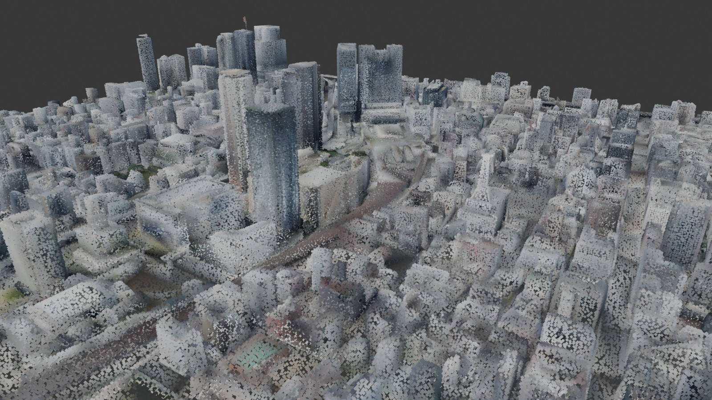
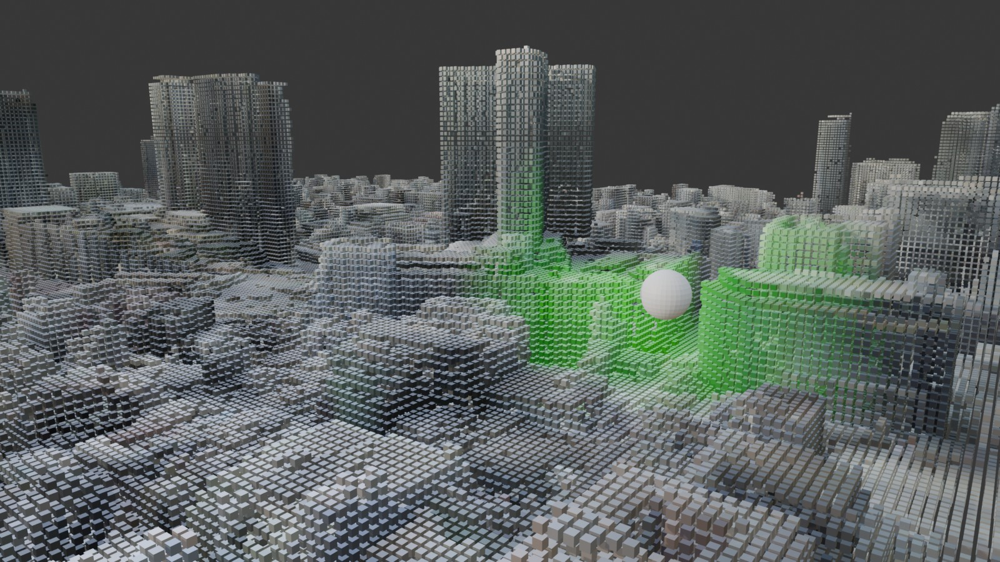
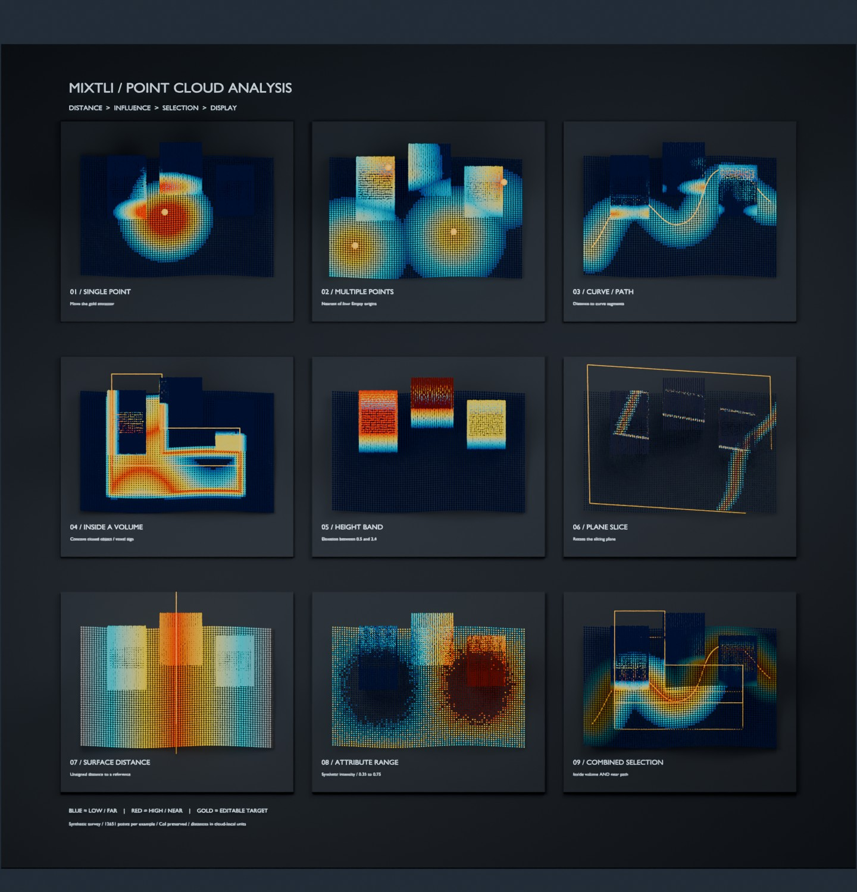
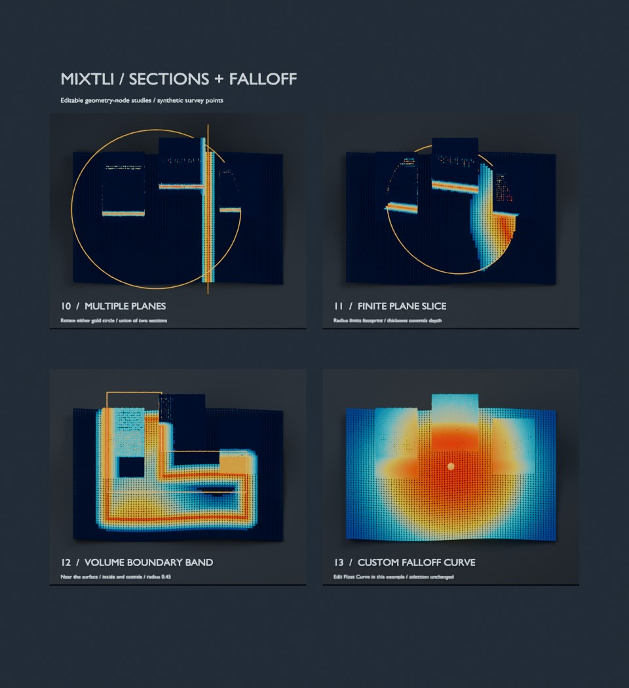
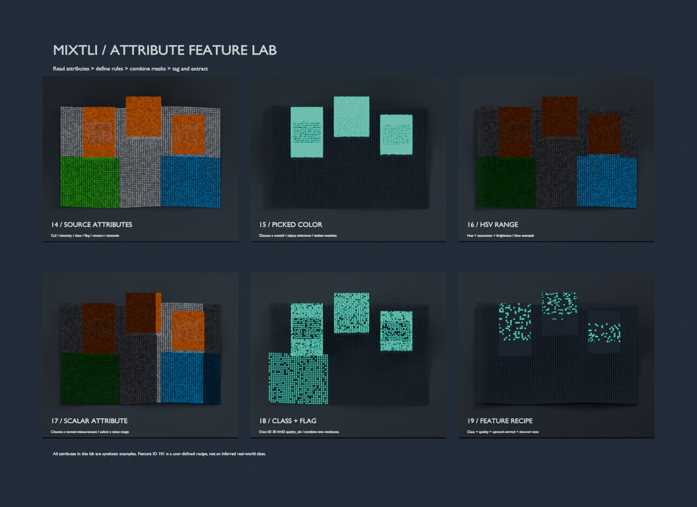

# Mixtli

**Generate, analyse and visualise point clouds.** *Mixtli* is Nahuatl for cloud.

Mixtli brings point clouds into Blender, gives you tools to interrogate them,
and renders the answer.

- **Generate** - from a textured mesh, however many material slots it carries,
  or from a cloud you already have. Over the surface, or filling the solid
  inside it.
- **Analyse** - select by distance, section, volume, height, or by an attribute
  the cloud came with.
- **Visualise** - results come out as colour, ready to light and render.

Point-cloud analysis tools exist elsewhere. What Blender adds is that the
answer is already an image.

## Install

Download the `.zip` from [Releases](https://github.com/luigipacheco/mixtli/releases),
then **Edit > Preferences > Get Extensions > Install from Disk**.

Blender 4.2 or newer. Works in EEVEE and Cycles.

## Quick start

1. Select a textured mesh - or an imported point cloud, either works.
2. Press `N` in the 3D view and open the **Mixtli** tab.
3. Click **Mesh to Colour Point Cloud**.
4. Leave the defaults and confirm.

You get a new `<name>_pointcloud` object. The original is never modified.

For a voxel grid: set **Points From** to *Regular Grid*, give **Voxel Size** a
value in metres, then raise **Scatter Points** until the dialog reads 25-50
points per cell. Set **Cell Position** to *Cell Centre* for a true lattice.

For a solid: set **Points From** to *Solid Fill*. The inside of the mesh fills
with the same lattice, and **Add Volume Node Group** makes the result a volume
in geometry nodes.

## Use

Select a mesh, open the **Mixtli** tab in the 3D view sidebar (`N`), hit the
button. Set the options in the dialog and confirm.

Already have a point cloud? Select that instead. Mixtli detects a `PointCloud`
object or a face-less mesh (how `.ply` clouds import), skips straight past the
material flattening, and offers just the grid and radius options - so you can
voxel-grid an imported scan, or simply give it a material and a live radius
slider.

**Points From** picks how the cloud is built:

| Mode | Output | Good for |
|---|---|---|
| Scatter on Faces | Mesh + geometry nodes | Live density you can scrub |
| Mesh Vertices | Mesh + geometry nodes | One point per vertex |
| Regular Grid | Real PointCloud object | Voxel grids, cleanup, PLY export |
| Solid Fill | Real PointCloud object | The inside too: solids, sections, volumes |

The dialog shows a live estimate of point count, spacing and radius as you
change settings, so you can tell before committing whether the numbers make
sense for your object.

### Regular Grid

- **Voxel Size** - grid cell size. 0 keeps the raw scattered points.
- **Scatter Points** - aim for 25-50 per cell (shown live). Too few and the
  grid comes out with holes.
- **Cell Position** - *Centroid* follows the surface, *Cell Centre* snaps to a
  perfectly regular lattice.
- **Min Points / Cell** - drops sparse cells. Cheap outlier removal. Keep it
  below the points-per-cell number or it deletes most of your cloud.
- **Export PLY** - under Advanced. Binary, with colour.

Output is a real `PointCloud` datablock with `position` / `radius` / `Col`, so
you can stack geometry nodes on it afterwards. On Blender 4.x, which has no
way to size a point cloud from Python, Mixtli builds the points as a mesh and
converts it, so the result is the same.

**Add Display Node Group** (Advanced, on by default) attaches a small shared
modifier with a **Radius Scale** slider, so point size stays adjustable
afterwards without re-running anything. It multiplies the stored per-point
radius rather than setting an absolute one, so a single group stays correct
across objects of any scale.

*Cell Centre grid, post-processed in geometry nodes: distance to the sphere
drives a Map Range into a colour mix.*

### Solid Fill

The other modes put points on the surface. *Solid Fill* puts them inside as
well: a regular lattice at **Voxel Size** through the whole body of the mesh,
with the surface cells on top, so the cloud is a solid you can section, count
cells in, or turn into a volume. Every point carries a `depth` attribute -
its distance to the surface, 0 on the surface itself - so the shell, the core
and anything in between is a *Compare* on `depth` away.

- **Fill Rule** - *Closed Mesh* casts rays through the lattice along all three
  axes and calls a cell inside when two of them agree, so a mesh that is
  closed, or nearly so, fills correctly; small holes and the odd missing face
  are outvoted. *Below Surface* fills everything under the topmost surface
  down to the mesh's lowest point, which is what terrain, photogrammetry
  sheets and 3D Tiles need - they have no underside to be inside of.
- **Fill Depth** - fill only this far below the surface, for a thick shell
  rather than a full solid. 0 fills everything.
- **Include Surface** - off keeps just the interior, for combining with a
  surface cloud you already have.
- **Interior Colour** - *Nearest Surface* gives each interior point the colour
  of the surface cell nearest to it, so a cut through a building shows the
  facade colour on the way in. *Flat* paints the inside one colour.
- **Surface Cells** - *Centroid* lets the surface cells follow the surface,
  *Cell Centre* keeps everything on the lattice.
- **Scatter Points** feeds the surface cells, as in Regular Grid; the inside
  comes from the triangles directly, so it has no holes to worry about.
- **Voxel Size** 0 picks a fiftieth of the longest side. The dialog shows the
  lattice size before you commit; it refuses lattices over 100 million cells.

The inside test is pure numpy and quick - a million-cell lattice takes well
under a second - and it is exact for watertight meshes.

### Use as a volume

**Add Volume Node Group** (in the dialog for Regular Grid and Solid Fill, and
for incoming clouds) or **Add Volume Modifier** (in the panel, for any selected
cloud or mesh) adds a shared *Mixtli Volume* geometry-nodes modifier that
turns the points into a fog volume with *Points to Volume*. From there any
volume node applies: *Volume to Mesh* for a surface, *Distribute Points in
Volume* for a new cloud, *Sample Volume* to read density, or a Principled
Volume material to render it as fog.

| Input | Does |
|---|---|
| **Voxel Scale** | voxel size as a multiple of the mean point radius |
| **Radius Scale** | each point's sphere as a multiple of its radius; 1.5 fuses lattice neighbours into a solid |
| **Density** | the value written into the `density` grid |
| **Mesh Output** | *Volume to Mesh* instead, wrapped in the point material: a watertight surface around the cloud |

Everything is relative to the stored per-point radius, like the Display
group, so one modifier is right for clouds of any scale, and the Display
group's **Radius Scale** feeds through. The volume gets the `Mixtli_Volume`
material - a Principled Volume, built once and then left as you edit it.
Drop the group on a mesh and its vertices become the points.

## Analyse

Mixtli ships a library of geometry-node groups for asking questions of a point
cloud, and registers it as an asset library on install. Open the Asset Browser
and look under **Mixtli**, or drag a group straight into a geometry-nodes tree.

Ask spatially - distance to a point, a set of points, a curve corridor or a
surface; inside a closed volume or the band near its boundary; plane and
multi-plane sections; height bands. Or ask by attribute: select a numeric range
on any named attribute the cloud carries.

| Catalog | Groups |
|---|---|
| Selection and Distance | point / multi-point / curve-corridor attractors, inside-a-closed-object, height band, plane slice, multiple plane slices, surface distance, attribute range |
| Display | heatmap point display |
| Utilities | combine selections, point statistics, points adapter, falloff curve |
| Starters | ready-made single-attractor and multi-plane setups |

Most analysis groups output `Distance`, `Influence`, `Selection` and `Valid`,
so they compose: feed any of them into **MX 10 | Heatmap point display** to
colour by the result, or into **MX 09 | Combine selections** to intersect two
of them. **MX 12 | Points adapter** takes a mesh or a point cloud and hands
back points, so the groups work on either.

**MX 11 | Point statistics is optional.** Nothing depends on it - no other
group calls it, and a selection works fine without it. It exists to read
numbers off a result: total and selected counts, selected fraction, and the
min, max and mean of the analysis value. Add it when you want the figures,
leave it out otherwise.

*Nine of the analysis groups on synthetic survey points. Blue is low or far,
red is high or near; gold marks the object you move.*

*Plane sections, volume boundary bands, and an editable falloff curve.*

### By source attribute

Point clouds arrive carrying data - colour, intensity, classification codes,
return numbers, normals. These groups read what is already there and turn it
into a selection.

| Group | Selects by |
|---|---|
| MX 17 \| Read source color | reads a colour attribute; RGB, HSV, luminance and alpha out |
| MX 18 \| Match source color | nearness to a picked swatch, optionally ignoring brightness |
| MX 19 \| HSV color range | hue, saturation and brightness bounds |
| MX 20 \| RGB vegetation candidates | green dominance, `ExG = 2g - r - b` |
| MX 21 \| Class ID selection | an integer class, or a range of them |
| MX 22 \| Vector attribute filter | a vector's length, or its alignment to a direction |
| MX 24 \| Boolean attribute rule | a boolean attribute being true or false |
| MX 25 \| Attribute relationships | difference, ratio or normalised difference of two attributes |
| MX 27 \| Scalar field rule | an inclusive numeric range on any scalar field |
| MX 26 \| Tag and extract feature | writes a feature ID and score, and splits matched from remaining |

Colour work happens in **display sRGB** by default, because that is the space
colour thresholds are normally quoted in. Mixtli stores `Col` as linear and
these groups convert on the way in; turn off **Use Display RGB** to stay
linear. The one exception is `MX 17`'s **Luminance**, which is always linear,
because that is what luminance means.

Worked examples: vegetation from ordinary photogrammetry colour is `MX 20`
into `MX 26`, tagged and split out. Classified LiDAR is `MX 21` with the ASPRS
code you want - 2 ground, 3-5 vegetation, 6 building, 9 water. With a
near-infrared and a red band, `MX 25`'s Normalized Difference is NDVI.

*Reading attributes, then narrowing: source data, a picked swatch, an HSV
range, a scalar range, two attributes combined, and a feature recipe that
stacks class, quality flag, surface direction and a channel ratio.*

## Visualise

**MX 10 | Heatmap point display** turns any analysis result into colour.

**Color Mode** decides how each point's colour is built:

| Mode | Colour |
|---|---|
| Heatmap | the analysis colour on its own |
| Mix | the analysis colour with the source colour blended over it by **Original Color Mix** |
| Source | the cloud's own colour, untouched |
| Multiply | the source colour modulated by the analysis colour, so texture detail survives the tint |

On a photogrammetry cloud, *Multiply* is usually what you want: the city still
looks like the city, and the analysis reads as a tint over it. Every mode falls
back to the analysis colour when the source attribute is missing, so nothing
ever comes out black.

- **Recolor Selection Only** - only selected points take the Color Mode colour;
  everything outside the selection keeps its own colour. Use it to recolour
  just what falls inside an attractor's influence radius and leave the rest of
  the cloud looking like itself.
- **Heatmap Low / Mid Low / Mid High / High** - four stops across the
  normalised value.
- **Use Selection Colors** - flat selected/unselected colours instead of the
  heatmap, for reading a selection at a glance.
- **Size By Value** with **Radius Gain** - magnitude reads as size as well as
  hue.
- **Isolate Selection** - delete unselected points rather than dimming them.
  **Unselected Brightness** sets the dimming when it is off, and applies in
  every Color Mode.

It also writes `mx_value`, `mx_weight`, `mx_selected`, `mx_valid` and
`mx_viz_color` as point attributes, so later nodes - or a script - can read
what it decided.

## GIS data

Bring a site's map data onto its point cloud: which building, landuse, park
or road each point belongs to, as point attributes you can colour by in one
click. Open **Mixtli > GIS Data**.

1. **Georeference.** Import the site with
   [Blosm](https://github.com/vvoovv/blender-osm) - Google 3D Tiles, OSM,
   terrain - and Mixtli reads the `scene["lat"]` / `scene["lon"]` it leaves
   behind. No Blosm? Choose *Manual*, type the origin, and **Write for Blosm**
   so later Blosm imports land in the same place.
2. **Get GIS Data** for the selected cloud(s):

   | Source | What |
   |---|---|
   | OpenStreetMap | downloaded from the Overpass API for the cloud's area, plus **Padding** |
   | GeoJSON File | any WGS84 GeoJSON - QGIS exports, city open-data portals |
   | OGC API Features | a standards-based feature server's `.../collections/{id}/items` URL |

   **Fields** lists the tags to fetch and map; blank maps every property.
   The data is kept in the text block `Mixtli GIS.geojson`, so it downloads
   once and re-maps offline.
3. **Map to Points** writes `gis_*` attributes and colours the cloud by the
   first one:

   | Attribute | Type | Meaning |
   |---|---|---|
   | `gis_building`, `gis_landuse`, ... | INT | tag value as a code, 0 = none; labels in the legend |
   | `gis_height`, `gis_building_levels`, ... | FLOAT | numeric tags (`"12 m"` reads as 12), 0 = none |
   | `gis_inside` | BOOL | inside any polygon |
   | `gis_feature` | INT | index of the smallest polygon containing the point |
   | `gis_line_dist` | FLOAT | metres to the nearest road / line, capped at **Line Distance** |
   | `gis_line_highway`, ... | INT | the nearest line's tag |

   Polygons nest: a point on a building inside a residential block gets both
   `building` and `landuse`. Each key comes from the smallest polygon that
   has it.
4. **Check Alignment** before trusting it. It slides the building footprints
   over the cloud's roofs, scores every shift, and reports the best one - in
   both of Blosm's frames - with an OpenStreetMap link for the cloud centre.
   If the fit is off, **Apply Suggested Fix** and map again. **Draw
   Features** puts the outlines over the cloud as wire edges, for checking
   by eye from the top view.

**View by Attribute** colours any point attribute - GIS, LiDAR
classification, intensity, anything scalar. Categories get a legend you can
recolour, rename and switch off value by value; numbers get a ramp with
editable bounds. It adds a *Mixtli View* modifier last on the stack;
**Source Colour** takes it away again. The attributes are ordinary ones, so
the analysis groups read them too: `gis_landuse` into **MX 21 | Class ID
selection**, `gis_height` into **MX 27 | Scalar field rule**.

What you set up stays. Each attribute's legend - colours, toggles, names,
ramp bounds - is remembered on the object, so switching to another attribute
and back finds it as you left it. The view material (`Mixtli_mx_view_color`)
and node group (`Mixtli_AttributeView`) are built once and never rebuilt
behind your back: edit them in the Shader or Node Editor and the edits
survive every change of attribute. The refresh button beside the legend
rebuilds both from scratch when you do want a clean slate.

### Correcting values

Map data is wrong sometimes - the museum tagged as a shop - and LiDAR
classes are wrong often. Fix them the way you would set a vertex weight:

1. **Tab** into Edit Mode and select the points (box select from the top
   view is usually enough). Point clouds need Blender 5.0+ for Edit Mode;
   mesh clouds edit anywhere.
2. Click the value in the legend. If it is not there yet, **+** adds one -
   type `museum` - and it is kept on the object.
3. **Assign**. With **Whole Feature** on, one point on a building is enough:
   every point of each GIS feature the selection touches takes the value.
   **Remove** sets the selection back to *none*; **Select** and
   **Deselect** pick out every point carrying the active value, to check or
   to build a selection from. Numbers get a field and **Assign** instead.

Corrections to `gis_*` attributes are recorded on the object by feature id,
so **Map to Points** puts them back after a remap - after fixing the
alignment, say, or fetching more fields. The panel shows how many are kept;
**x** forgets them. Renamed values are kept as names, not re-applied: a
remap takes its names from the data again.

### Frames

Blosm places data in two different ways, and they do not agree:

- **OSM / Terrain** - a spherical Transverse Mercator about the scene origin.
- **3D Tiles** - true earth-centred coordinates rotated to the origin, with a
  slight tilt from using geocentric latitude.

They drift apart by 0.2-0.7% of the distance from the origin (2-7 m per km),
and the tilt adds about 0.2% of the ground height: roughly 5 m in a city at
2,200 m. So features must be mapped in the frame the cloud was imported in.
*Auto* picks 3D Tiles when the cloud sits in a Blosm "3D Tiles" collection,
which is where a cloud made from tiles lands; **Check Alignment** tells you if
the other frame fits better.

Map data must be in WGS84 (EPSG:4326). Reproject in QGIS first if it is not.
OpenStreetMap data is (c) OpenStreetMap contributors, under the ODbL. Credit
it wherever the result is shown. Downloading needs **Allow Online Access** in
Blender's preferences; nothing goes online unless you click **Get GIS Data**
with an online source.

Attributes go onto real points: a `PointCloud` (Regular Grid output, or an
imported cloud) or a mesh's vertices. A live *Scatter on Faces* cloud
interpolates vertex attributes across its points, which blurs category edges.
Use Regular Grid output for crisp boundaries.

## Notes

Colour comes from reading texture pixels through the UVs - no bake, no UV
unwrap, seconds not minutes. Shaders too complex to resolve fall back to a
Cycles bake automatically. sRGB is decoded to linear so colours do not come
out gamma-shifted.

The point material reads the colour attribute into a Principled BSDF, so
the points are lit like everything else in the scene and EEVEE and Cycles
agree on them. **Shader: Emission** under Advanced gives the flat, unlit look
instead. Either way the material is built once, per attribute name, and
reused as it is on later runs - so your own edits to it stick - unless you
tick **Rebuild Material**. Cycles is needed only for the bake fallback,
because EEVEE has no bake operator - and if Cycles is disabled, Mixtli tells
you rather than failing.

Only needs numpy, which Blender already ships.

## Licence

GPL-3.0-or-later.
