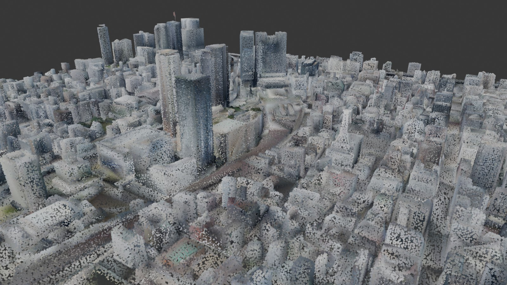
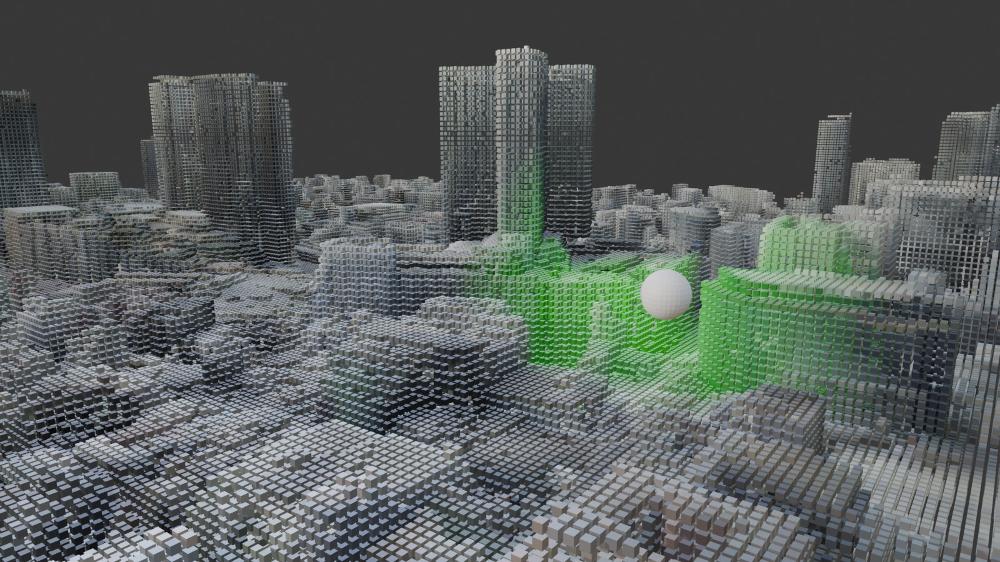
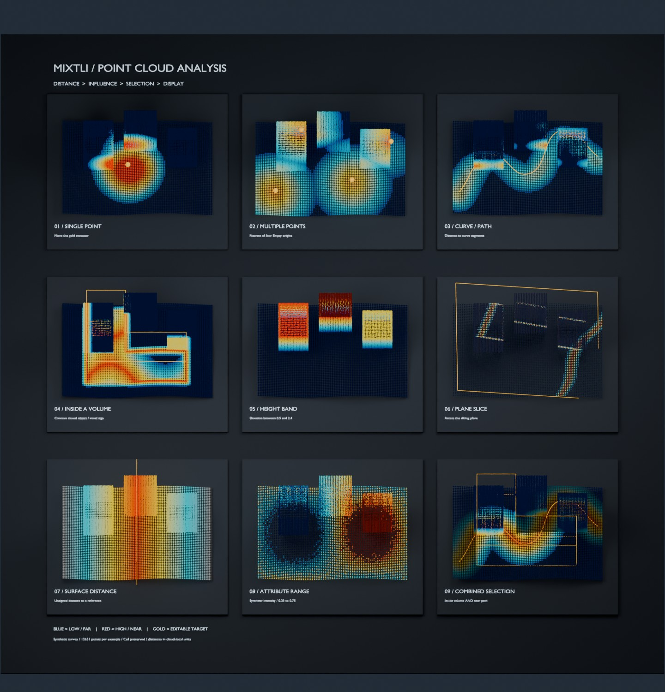
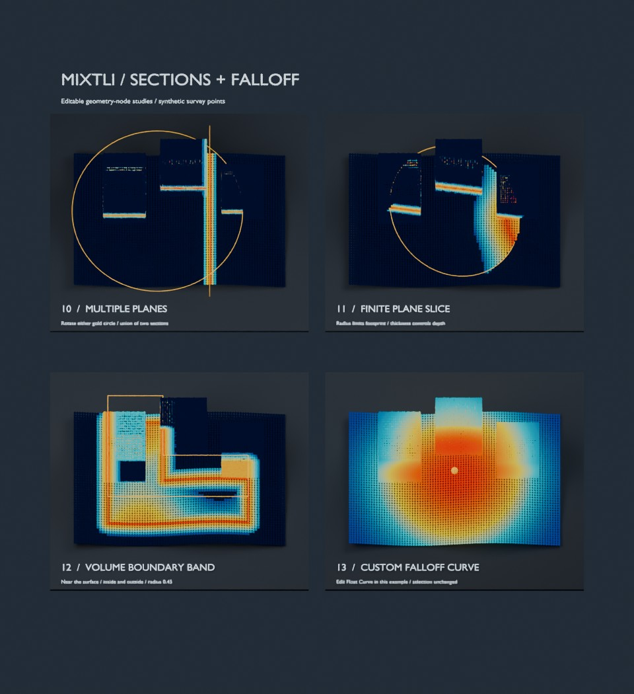
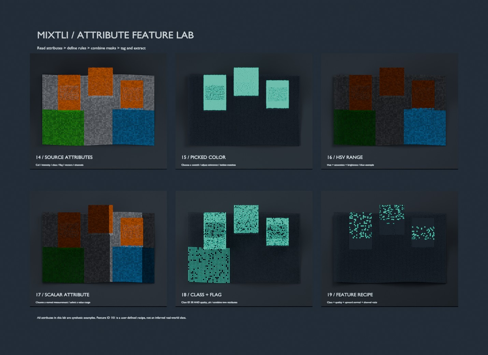

# Mixtli

**Generate, analyse and visualise point clouds.** *Mixtli* is Nahuatl for cloud.

Mixtli brings point clouds into Blender, gives you tools to interrogate them,
and renders the answer.

- **Generate** - from Google Photorealistic 3D Tiles for any place, from a
  textured mesh however many material slots it carries, or from a LiDAR or
  scan file you already have.
- **Analyse** - select by distance, section, volume, height, or by an attribute
  the cloud came with.
- **Visualise** - results come out as colour, ready to light and render.

Point-cloud analysis tools exist elsewhere. What Blender adds is that the
answer is already an image.

## Install

Download the `.zip` from [Releases](https://github.com/luigipacheco/mixtli/releases),
then **Edit > Preferences > Get Extensions > Install from Disk**.

Blender 4.2 or newer. Works in EEVEE and Cycles.

## Quick start: a site in three clicks

1. Put a Google Maps API key in **Edit > Preferences > Add-ons > Mixtli**
   (see [Google key](#google-key)).
2. Press `N` in the 3D view, open **Mixtli > Site from Google 3D Tiles**, and
   type a place - an address, a landmark, or `lat, lon` copied from Google
   Maps.
3. Click **Build Site**.

Mixtli downloads the 3D Tiles around the place, turns them into a gridded
point cloud, downloads OpenStreetMap for the same area, maps it onto the
points and colours the cloud by the first GIS attribute. Pick another one
in **View by Attribute**, or click **Above Ground** for building and canopy
heights.

## Quick start: a mesh or scan

1. Select a textured mesh - or an imported point cloud, either works.
2. Press `N` in the 3D view and open the **Mixtli** tab.
3. Click **Make Point Cloud**.
4. Leave the defaults and confirm.

You get a new `<name>_pointcloud` object. The original is never modified.

For a voxel grid: set **Points From** to *Regular Grid*, give **Voxel Size** a
value in metres, then raise **Scatter Points** until the dialog reads 25-50
points per cell. Set **Cell Position** to *Cell Centre* for a true lattice.

## Use

Select a mesh, open the **Mixtli** tab in the 3D view sidebar (`N`), hit the
button. Set the options in the dialog and confirm.

Already have a point cloud? Select that instead. Mixtli detects a `PointCloud`
object or a face-less mesh (how `.ply` clouds import), skips straight past the
material flattening, and offers just the grid and radius options - so you can
voxel-grid an imported scan, or simply give it a material and a live radius
slider.

**Points From** picks how the cloud is built:

| Mode | Output | Good for |
|---|---|---|
| Scatter on Faces | Mesh + geometry nodes | Live density you can scrub |
| Mesh Vertices | Mesh + geometry nodes | One point per vertex |
| Regular Grid | Real PointCloud object | Voxel grids, cleanup, PLY export |

The dialog shows a live estimate of point count, spacing and radius as you
change settings, so you can tell before committing whether the numbers make
sense for your object.

### Regular Grid

- **Voxel Size** - grid cell size. 0 keeps the raw scattered points.
- **Scatter Points** - aim for 25-50 per cell (shown live). Too few and the
  grid comes out with holes.
- **Cell Position** - *Centroid* follows the surface, *Cell Centre* snaps to a
  perfectly regular lattice.
- **Min Points / Cell** - drops sparse cells. Cheap outlier removal. Keep it
  below the points-per-cell number or it deletes most of your cloud.
- **Export PLY** - under Advanced. Binary, with colour.

Output is a real `PointCloud` datablock with `position` / `radius` / `Col`, so
you can stack geometry nodes on it afterwards.

**Add Display Node Group** (Advanced, on by default) attaches a small shared
modifier with a **Radius Scale** slider, so point size stays adjustable
afterwards without re-running anything. It multiplies the stored per-point
radius rather than setting an absolute one, so a single group stays correct
across objects of any scale.

*Cell Centre grid, post-processed in geometry nodes: distance to the sphere
drives a Map Range into a colour mix.*

## Site from Google 3D Tiles

**Mixtli > Site from Google 3D Tiles** imports Google's Photorealistic 3D
Tiles straight from the Map Tiles API. No other add-on is needed.

| Setting | What it does |
|---|---|
| Place | an address or place name (looked up on OpenStreetMap Nominatim), or `lat, lon` |
| Radius | tiles within this horizontal distance of the place |
| Detail | *Low* for massing over big areas, *Medium* for buildings, *High* for facades and trees, *Max* for the finest tiles (small areas only) |
| Point Cloud / GIS Data | which steps **Build Site** runs after the import |
| Point Spacing | voxel size of the cloud made from the tiles |

**Build Site** runs the whole chain: tiles, then a Regular Grid point cloud,
then OpenStreetMap through **Get GIS Data** and **Map to Points**. Each step
is the ordinary operator, so you can also run them one at a time:
**Import Tiles Only**, then **Point Cloud > Make Point Cloud**, then
**GIS Data**.

The tiles land as one textured mesh in a *Google 3D Tiles* collection, in
the same earth-centred frame Blosm uses for 3D Tiles. Mixtli writes
`scene["lat"]` / `scene["lon"]` the way Blosm does. A second site within
20 km reuses that origin, so neighbouring imports, Blosm data and GIS
features all line up. The tile transforms are composed in double precision
before anything reaches Blender, which stores float32. Doing it the other
way round would round earth-centred coordinates to half a metre.

**Max Tiles** under Options (600 by default) refuses a request before
anything is downloaded, so a radius that is too big for the detail level
does not turn into thousands of downloads.

### Google key

1. [console.cloud.google.com](https://console.cloud.google.com) > create a
   project with billing enabled.
2. **APIs & Services > Library > Map Tiles API > Enable**.
3. **Credentials > Create credentials > API key**. Restricting it to the Map
   Tiles API is a good idea.
4. Paste it into **Preferences > Add-ons > Mixtli**, or set the
   `GOOGLE_MAPS_API_KEY` environment variable.

The key is kept in your Blender preferences and never saved in the .blend
file. Google bills tile requests past a monthly free allowance, and its
terms apply to the tiles: show the data attribution wherever the result is
shown. Mixtli stores the credit line from the tiles on the object, as
`mixtli_tiles`, and prints it after every import.

## Import point cloud files

**File > Import > Point Cloud - LAS, PLY, XYZ (Mixtli)**, or **Import LAS /
PLY / XYZ** in the Point Cloud panel. Every attribute the file carries comes
through as a point attribute:

| Format | Attributes |
|---|---|
| LAS 1.0-1.4, point formats 0-10 | `classification`, `intensity`, `return_number`, `number_of_returns`, `scan_angle`, `user_data`, `point_source_id`, `gps_time`, `nir`, `withheld`, colour |
| PLY, ASCII or binary | every vertex property: colour, `normal`, and scalar fields such as confidence or curvature |
| XYZ / TXT / CSV / PTS | named by a header line, or by column count: xyz, xyzi, xyzrgb, xyzirgb |

LiDAR comes in map coordinates far from the origin, where float32 runs out
of precision. **Recentre** shifts it near the origin and records the shift
as `mixtli_origin`. Files imported later get the same shift, so adjacent
tiles stay aligned. **Thin to Voxel** keeps one point per cell on the way
in. A classified file opens coloured by `classification`, with ASPRS names
in the legend.

LAZ is not supported: it is compressed with a codec numpy cannot read.
Decompress it first with `laszip -i in.laz -o out.las` or `pdal translate`,
or save it as LAS from CloudCompare. GIS mapping needs a lat/lon
georeference (tiles or Blosm). Projected LiDAR coordinates are not
reprojected.

Gridding an existing cloud with **Make Point Cloud** keeps its attributes.
Numbers are averaged per cell. Class codes, GIS categories and booleans take
the most common value in the cell, because the average of *ground* and
*building* is not a class.

## Analyse

Mixtli ships a library of geometry-node groups for asking questions of a point
cloud, and registers it as an asset library on install. Open the Asset Browser
and look under **Mixtli**, or drag a group straight into a geometry-nodes tree.

Ask spatially - distance to a point, a set of points, a curve corridor or a
surface; inside a closed volume or the band near its boundary; plane and
multi-plane sections; height bands. Or ask by attribute: select a numeric range
on any named attribute the cloud carries.

| Catalog | Groups |
|---|---|
| Selection and Distance | point / multi-point / curve-corridor attractors, inside-a-closed-object, height band, plane slice, multiple plane slices, surface distance, attribute range |
| Display | heatmap point display |
| Utilities | combine selections, point statistics, points adapter, falloff curve |
| Starters | ready-made single-attractor and multi-plane setups |

Most analysis groups output `Distance`, `Influence`, `Selection` and `Valid`,
so they compose: feed any of them into **MX 10 | Heatmap point display** to
colour by the result, or into **MX 09 | Combine selections** to intersect two
of them. **MX 12 | Points adapter** takes a mesh or a point cloud and hands
back points, so the groups work on either.

**MX 11 | Point statistics is optional.** Nothing depends on it - no other
group calls it, and a selection works fine without it. It exists to read
numbers off a result: total and selected counts, selected fraction, and the
min, max and mean of the analysis value. Add it when you want the figures,
leave it out otherwise.

*Nine of the analysis groups on synthetic survey points. Blue is low or far,
red is high or near; gold marks the object you move.*

*Plane sections, volume boundary bands, and an editable falloff curve.*

### By source attribute

Point clouds arrive carrying data - colour, intensity, classification codes,
return numbers, normals. These groups read what is already there and turn it
into a selection.

| Group | Selects by |
|---|---|
| MX 17 \| Read source color | reads a colour attribute; RGB, HSV, luminance and alpha out |
| MX 18 \| Match source color | nearness to a picked swatch, optionally ignoring brightness |
| MX 19 \| HSV color range | hue, saturation and brightness bounds |
| MX 20 \| RGB vegetation candidates | green dominance, `ExG = 2g - r - b` |
| MX 21 \| Class ID selection | an integer class, or a range of them |
| MX 22 \| Vector attribute filter | a vector's length, or its alignment to a direction |
| MX 24 \| Boolean attribute rule | a boolean attribute being true or false |
| MX 25 \| Attribute relationships | difference, ratio or normalised difference of two attributes |
| MX 27 \| Scalar field rule | an inclusive numeric range on any scalar field |
| MX 26 \| Tag and extract feature | writes a feature ID and score, and splits matched from remaining |

Colour work happens in **display sRGB** by default, because that is the space
colour thresholds are normally quoted in. Mixtli stores `Col` as linear and
these groups convert on the way in; turn off **Use Display RGB** to stay
linear. The one exception is `MX 17`'s **Luminance**, which is always linear,
because that is what luminance means.

Worked examples: vegetation from ordinary photogrammetry colour is `MX 20`
into `MX 26`, tagged and split out. Classified LiDAR is `MX 21` with the ASPRS
code you want - 2 ground, 3-5 vegetation, 6 building, 9 water. With a
near-infrared and a red band, `MX 25`'s Normalized Difference is NDVI.

*Reading attributes, then narrowing: source data, a picked swatch, an HSV
range, a scalar range, two attributes combined, and a feature recipe that
stacks class, quality flag, surface direction and a channel ratio.*

## Visualise

**MX 10 | Heatmap point display** turns any analysis result into colour.

**Color Mode** decides how each point's colour is built:

| Mode | Colour |
|---|---|
| Heatmap | the analysis colour on its own |
| Mix | the analysis colour with the source colour blended over it by **Original Color Mix** |
| Source | the cloud's own colour, untouched |
| Multiply | the source colour modulated by the analysis colour, so texture detail survives the tint |

On a photogrammetry cloud, *Multiply* is usually what you want: the city still
looks like the city, and the analysis reads as a tint over it. Every mode falls
back to the analysis colour when the source attribute is missing, so nothing
ever comes out black.

- **Recolor Selection Only** - only selected points take the Color Mode colour;
  everything outside the selection keeps its own colour. Use it to recolour
  just what falls inside an attractor's influence radius and leave the rest of
  the cloud looking like itself.
- **Heatmap Low / Mid Low / Mid High / High** - four stops across the
  normalised value.
- **Use Selection Colors** - flat selected/unselected colours instead of the
  heatmap, for reading a selection at a glance.
- **Size By Value** with **Radius Gain** - magnitude reads as size as well as
  hue.
- **Isolate Selection** - delete unselected points rather than dimming them.
  **Unselected Brightness** sets the dimming when it is off, and applies in
  every Color Mode.

It also writes `mx_value`, `mx_weight`, `mx_selected`, `mx_valid` and
`mx_viz_color` as point attributes, so later nodes - or a script - can read
what it decided.

## GIS data

Bring a site's map data onto its point cloud: which building, landuse, park
or road each point belongs to, as point attributes you can colour by in one
click. Open **Mixtli > GIS Data**.

1. **Georeference.** Import the site with **Site from Google 3D Tiles**, or
   with [Blosm](https://github.com/vvoovv/blender-osm) (OSM, terrain), and
   Mixtli reads the `scene["lat"]` / `scene["lon"]` that the import leaves
   behind. For anything else, choose *Manual*, type the origin, and **Write
   for Blosm** so that later imports land in the same place.
2. **Get GIS Data** for the selected cloud(s):

   | Source | What |
   |---|---|
   | OpenStreetMap | downloaded from the Overpass API for the cloud's area, plus **Padding** |
   | GeoJSON File | any WGS84 GeoJSON - QGIS exports, city open-data portals |
   | OGC API Features | a standards-based feature server's `.../collections/{id}/items` URL |

   **Fields** lists the tags to fetch and map; blank maps every property.
   The data is kept in the text block `Mixtli GIS.geojson`, so it downloads
   once and re-maps offline.
3. **Map to Points** writes `gis_*` attributes and colours the cloud by the
   first one:

   | Attribute | Type | Meaning |
   |---|---|---|
   | `gis_building`, `gis_landuse`, ... | INT | tag value as a code, 0 = none; labels in the legend |
   | `gis_height`, `gis_building_levels`, ... | FLOAT | numeric tags (`"12 m"` reads as 12), 0 = none |
   | `gis_inside` | BOOL | inside any polygon |
   | `gis_feature` | INT | index of the smallest polygon containing the point |
   | `gis_line_dist` | FLOAT | metres to the nearest road / line, capped at **Line Distance** |
   | `gis_line_highway`, ... | INT | the nearest line's tag |

   Polygons nest: a point on a building inside a residential block gets both
   `building` and `landuse`. Each key comes from the smallest polygon that
   has it.
4. **Check Alignment** before trusting it. It slides the building footprints
   over the cloud's roofs, scores every shift, and reports the best one - in
   both of Blosm's frames - with an OpenStreetMap link for the cloud centre.
   If the fit is off, **Apply Suggested Fix** and map again. **Draw
   Features** puts the outlines over the cloud as wire edges, for checking
   by eye from the top view.

### Frames

Blosm places data in two different ways, and they do not agree:

- **OSM / Terrain** - a spherical Transverse Mercator about the scene origin.
- **3D Tiles** - true earth-centred coordinates rotated to the origin, with a
  slight tilt from using geocentric latitude.

They drift apart by 0.2-0.7% of the distance from the origin (2-7 m per km),
and the tilt adds about 0.2% of the ground height: roughly 5 m in a city at
2,200 m. So features must be mapped in the frame the cloud was imported in.
*Auto* picks 3D Tiles when the cloud sits in a Blosm "3D Tiles" collection,
which is where a cloud made from tiles lands; **Check Alignment** tells you if
the other frame fits better.

Map data must be in WGS84 (EPSG:4326). Reproject in QGIS first if it is not.
OpenStreetMap data is (c) OpenStreetMap contributors, under the ODbL. Credit
it wherever the result is shown. Downloading needs **Allow Online Access** in
Blender's preferences; nothing goes online unless you click **Get GIS Data**
with an online source.

Attributes go onto real points: a `PointCloud` (Regular Grid output, or an
imported cloud) or a mesh's vertices. A live *Scatter on Faces* cloud
interpolates vertex attributes across its points, which blurs category edges.
Use Regular Grid output for crisp boundaries.

## View by Attribute

**View by Attribute** colours the active cloud by any point attribute: GIS,
LiDAR classification, intensity, scalar fields, colours or normals. Pick it
from the search field, or click one of the buttons listed under it. The
cloud recolours at once.

- **Categories** get a legend. You can recolour each value and switch it
  off. **Hide Off / Out of Range** removes switched-off values instead of
  dimming them, so you can isolate *building* or *park*.
- **Numbers** get a ramp (*Viridis*, *Terrain*, *Heat*, *Diverging*, *Grey*)
  with editable **Low** / **High** bounds. With hiding on, the bounds act
  as a filter: everything over 20 m, every point within 5 m of a road.
- **Colours** show as they are, and **vectors** (normals) show as a normal
  map.
- **Elevation** writes each point's world Z as `elevation`. **Above
  Ground** writes `height_above_ground`, measured from the lowest ground
  within 60 m. That is good for building and canopy heights; on steep
  slopes it reads high.

All of this goes through a *Mixtli View* modifier placed last on the
stack. **Source Colour** removes it again.

The attributes are ordinary ones, so the analysis groups read them too: `gis_landuse` into **MX 21 | Class ID
selection**, `gis_height` into **MX 27 | Scalar field rule**.

## Notes

Colour comes from reading texture pixels through the UVs - no bake, no UV
unwrap, seconds not minutes. Shaders too complex to resolve fall back to a
Cycles bake automatically. sRGB is decoded to linear so colours do not come
out gamma-shifted.

Both engines render Mixtli output the same way: the point material is an
emission shader reading a colour attribute, which EEVEE and Cycles agree on.
Cycles is needed only for the bake fallback, because EEVEE has no bake
operator - and if Cycles is disabled, Mixtli tells you rather than failing.

Only needs numpy, which Blender already ships.

## Licence

GPL-3.0-or-later.
